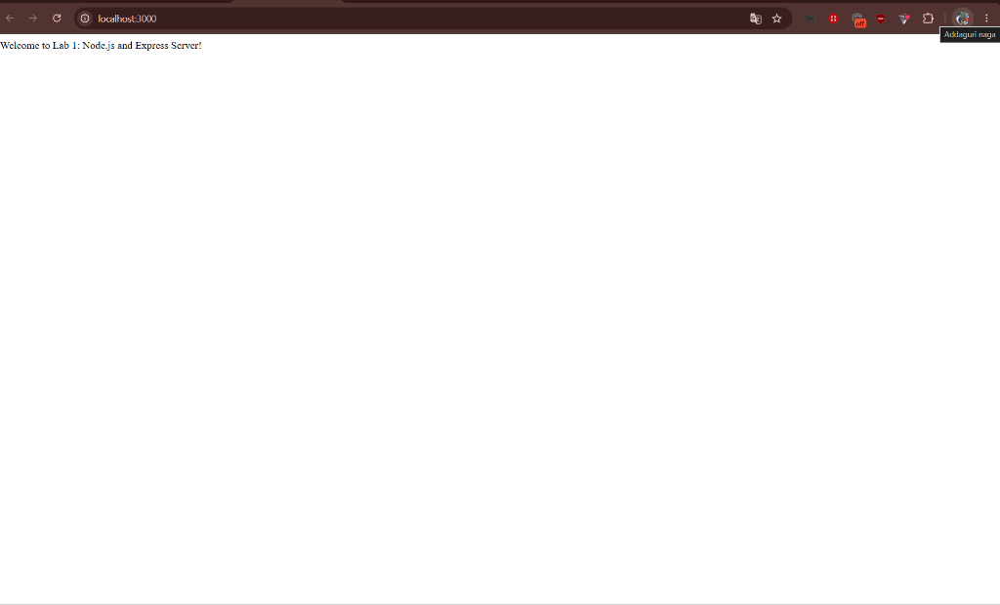
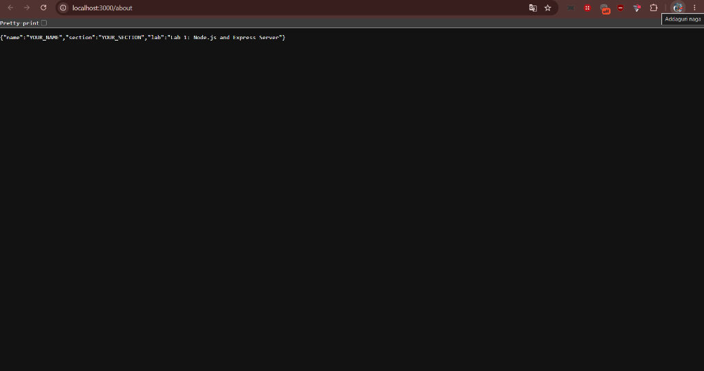
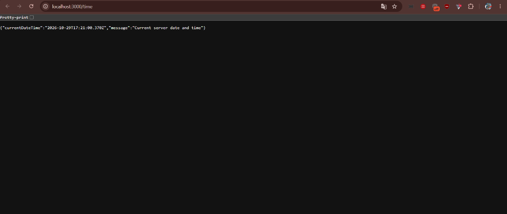
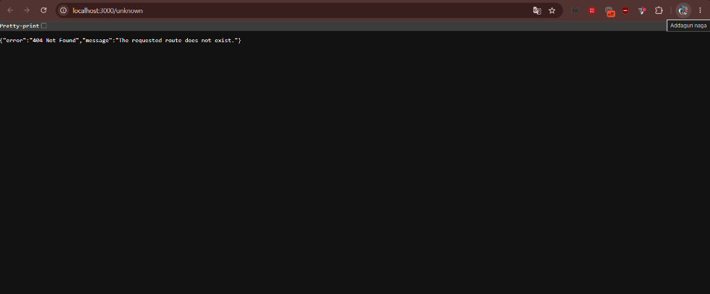

# Lab 1: Node.js and Express Server

**Institution:** Aurora  
**Department:** Computer Science and Engineering  
**Degree:** B.Tech CSE  
**Subject:** Backend Development Fundamentals  
**Module:** Node.js and Express.js Fundamentals  
**Faculty / Instructor:** Joel Prashanth D  
**Academic Year:** 2026–2027  

---

## Student Details

- **Student Name:** `[YOUR_NAME]`
- **Registration Number:** `[YOUR_REGISTRATION_NUMBER]`
- **Section / Branch:** `[YOUR_SECTION]` / B.Tech CSE
- **Lab Instructor / Faculty:** Joel Prashanth D
- **Public Deployment URL:** `Not deployed yet` *(Replace with your Render live URL once deployed, e.g., `https://lab-01-node-express.onrender.com`)*

---

## 1. Objective

The objectives of this laboratory session are:
1. To understand the **Node.js runtime environment** and its asynchronous, single-threaded, event-driven architecture.
2. To create a low-level HTTP server using Node.js's built-in `http` module and comprehend the request-response lifecycle.
3. To build a robust web server using the **Express.js** framework and implement standard REST routing (`GET` endpoints).
4. To handle multiple data formats including **plain text** and structured **JSON** responses.
5. To understand the concept and execution order of **Express Middleware**, specifically implementing a fallback 404 error handler.
6. To configure a standard `package.json`, manage dependencies using `npm`, and practice clean Git version control with `.gitignore`.

---

## 2. Technologies Used

- **Runtime Environment:** [Node.js](https://nodejs.org/) (v18.x / v20.x / v24.x)
- **Web Framework:** [Express.js](https://expressjs.com/) (v4.x)
- **Language:** JavaScript (ES6+ / CommonJS)
- **Package Manager:** npm (Node Package Manager)
- **Development Tooling:** Nodemon (optional hot-reloading)
- **Version Control:** Git & GitHub
- **Deployment Platform:** Render / Railway

---

## 3. Prerequisites

Before running this project, ensure you have the following installed on your machine:
- **Node.js** (v16.0.0 or higher). Verify with:
  ```bash
  node -v
  ```
- **npm** (v8.0.0 or higher). Verify with:
  ```bash
  npm -v
  ```
- **Git** (for version control). Verify with:
  ```bash
  git --version
  ```
- A modern web browser (Google Chrome, Microsoft Edge, Mozilla Firefox) or **Postman** for testing API endpoints.

---

## 4. Project Folder Structure

This lab is organized under the multi-lab repository structure:

```text
backend-development-fundamentals/
└── lab-01/
    ├── .gitignore          # Prevents committing node_modules, .env, OS files
    ├── package.json        # Project metadata, dependencies, and npm scripts
    ├── package-lock.json   # Exact dependency tree lockfile
    ├── basic-server.js     # Native Node.js HTTP server (built-in http module)
    ├── server.js           # Express.js server with REST endpoints & 404 handler
    ├── README.md           # Documentation, viva guide, and test logs
    └── screenshots/        # Directory containing endpoint test screenshots
        ├── README.md       # Screenshot guide
        ├── home.png        # Screenshot of GET /
        ├── about.png       # Screenshot of GET /about
        ├── time.png        # Screenshot of GET /time
        └── not-found.png   # Screenshot of 404 error route
```

### File Descriptions:
- **`basic-server.js`**: Demonstrates the core `http.createServer()` method built into Node.js. It responds with plain text `"Hello"` on port 3000 without requiring any third-party packages.
- **`server.js`**: Production-ready Express.js server implementing 3 valid GET routes, environment port binding (`process.env.PORT`), dynamic date handling, and a terminal 404 catch-all middleware.
- **`package.json`**: Manifest declaring project scripts (`npm start`, `npm run dev`, `npm run start:basic`) and dependencies.
- **`.gitignore`**: Guarantees that heavy directories (`node_modules/`) and sensitive files (`.env`) are never pushed to the remote Git repository.

---

## 5. Installation Instructions

1. Open your terminal (PowerShell, Command Prompt, or Bash).
2. Clone or navigate to the project directory:
   ```bash
   cd path/to/backend-development-fundamentals/lab-01
   ```
3. Install the required dependencies:
   ```bash
   npm install
   ```
   *This reads `package.json` and downloads Express into the local `node_modules/` folder while generating `package-lock.json`.*

---

## 6. How to Run the Applications

### A. Running the Basic HTTP Server (`basic-server.js`)
To run the server built using Node.js's native `http` module:
```bash
node basic-server.js
# OR using the npm shortcut:
npm run start:basic
```
**Expected Terminal Output:**
```text
====================================================
   Basic Node.js HTTP Server (Built-in http module)
====================================================
 Server started successfully!
 Access URL : http://localhost:3000
 Response   : Hello (Plain Text)
 Stop Server: Press Ctrl + C
====================================================
```
To stop the server, press `Ctrl + C` in your terminal.

---

### B. Running the Express Server (`server.js`)
To run the main Express server:
```bash
node server.js
# OR using the standard start script:
npm start
```

### C. Running in Development Mode (Optional with auto-restart)
```bash
npm run dev
```

**Expected Terminal Output:**
```text
====================================================
   Express.js Web Server (Backend Fundamentals)
====================================================
 Server successfully started!
 Running at: http://localhost:3000
 Port Mode : Local Default (3000)
 Available Endpoints:
   - GET  http://localhost:3000/
   - GET  http://localhost:3000/about
   - GET  http://localhost:3000/time
   - 404  http://localhost:3000/unknown (or any undefined route)
 Stop Server: Press Ctrl + C
====================================================
```

---

## 7. API Endpoints Specification

| HTTP Method | Route / Endpoint | Description / Purpose | HTTP Status Code | Content-Type | Sample Response |
| :--- | :--- | :--- | :--- | :--- | :--- |
| **GET** | `/` | Root endpoint welcoming the user | `200 OK` | `text/html; charset=utf-8` | `Welcome to Lab 1: Node.js and Express Server!` |
| **GET** | `/about` | Returns student information & metadata | `200 OK` | `application/json; charset=utf-8` | `{"name":"YOUR_NAME","section":"YOUR_SECTION","lab":"Lab 1: Node.js and Express Server"}` |
| **GET** | `/time` | Returns dynamic current server timestamp | `200 OK` | `application/json; charset=utf-8` | `{"currentDateTime":"2026-10-29T16:02:42.197Z","message":"Current server date and time"}` |
| **ALL** | `/unknown` *(any undefined)* | Catch-all 404 handler for missing routes | `404 Not Found` | `application/json; charset=utf-8` | `{"error":"404 Not Found","message":"The requested route does not exist."}` |

---

## 8. Endpoint Screenshots

> **Note for Student:** After running the server locally, open each URL in your browser or Postman, capture a screenshot, and place the image file in the `lab-01/screenshots/` folder using the exact filenames listed below.

### 1. Home Endpoint (`GET /`)
URL: `http://localhost:3000/`  
Expected Status: `200 OK`  


---

### 2. About Endpoint (`GET /about`)
URL: `http://localhost:3000/about`  
Expected Status: `200 OK`  


---

### 3. Time Endpoint (`GET /time`)
URL: `http://localhost:3000/time`  
Expected Status: `200 OK`  


---

### 4. 404 Not Found Handling (`GET /unknown`)
URL: `http://localhost:3000/unknown` (or any non-existent route)  
Expected Status: `404 Not Found`  


---

### How to Capture and Save Actual Screenshots:
1. **Start the Express server**: Run `npm start` in the `lab-01` folder.
2. **Open your web browser** (Chrome / Edge / Firefox).
3. **Visit each endpoint**:
   - `http://localhost:3000/`
   - `http://localhost:3000/about`
   - `http://localhost:3000/time`
   - `http://localhost:3000/unknown`
4. **Take a screenshot**:
   - On Windows: Press `Win + Shift + S`, select the browser window with the response and URL bar, and save.
   - On macOS: Press `Cmd + Shift + 4`, select the region, and save.
5. **Save the files**: Save each image inside `backend-development-fundamentals/lab-01/screenshots/` with the exact names:
   - `home.png`
   - `about.png`
   - `time.png`
   - `not-found.png`

---

## 9. Testing Instructions

### A. Testing via Web Browser
1. Start the server using `npm start`.
2. Open your browser and navigate to:
   - `http://localhost:3000/` -> Displays the welcome text string.
   - `http://localhost:3000/about` -> Displays formatted JSON with your name and section.
   - `http://localhost:3000/time` -> Displays JSON with the dynamic timestamp. Refreshing the browser updates the timestamp.
   - `http://localhost:3000/random-route` -> Displays the 404 JSON error response.

### B. How to Verify HTTP Status Codes in Browser Developer Tools
1. In Google Chrome or Microsoft Edge, press `F12` (or right-click anywhere and select **Inspect**).
2. Click on the **Network** tab.
3. Refresh the page (`F5` or `Ctrl + R`).
4. Look at the first entry under the **Name** column:
   - For `/`, `/about`, and `/time`, the **Status** column displays `200 OK` in green.
   - For `/unknown`, the **Status** column displays `404 Not Found` in red.
5. Click on the request entry and check the **Headers** sub-tab to inspect `Status Code` and `Content-Type`.

### C. Testing via Command Line (`curl`)
You can also verify all routes directly from your terminal:
```bash
# Test GET /
curl -i http://localhost:3000/

# Test GET /about
curl -i http://localhost:3000/about

# Test GET /time
curl -i http://localhost:3000/time

# Test 404 handler
curl -i http://localhost:3000/unknown
```
The `-i` flag prints the HTTP response headers (including the status code and Content-Type) alongside the body.

---

## 10. Troubleshooting & Common Errors

### 1. Error: `EADDRINUSE: address already in use :::3000`
- **Cause:** Another program or an orphaned Node.js background process is already using port 3000.
- **Solution (Windows):**
  1. Find the Process ID (PID) occupying port 3000:
     ```powershell
     netstat -ano | findstr :3000
     ```
  2. Kill the process by its PID (replace `<PID>` with the actual number from column 5):
     ```powershell
     taskkill /PID <PID> /F
     ```
- **Solution (macOS / Linux):**
  1. Find and terminate the process:
     ```bash
     npx kill-port 3000
     # OR manually:
     lsof -i :3000
     kill -9 <PID>
     ```
- **Alternative:** Run the server on a different port using an environment variable without modifying the code:
  ```bash
  # Windows PowerShell
  $env:PORT="3001"; node server.js

  # macOS / Linux
  PORT=3001 node server.js
  ```

### 2. 404 Handler Triggering for All Routes
- **Cause:** Placing `app.use((req, res) => ...)` **before** `app.get('/', ...)` or other route definitions.
- **Solution:** In Express, middleware executes sequentially in the order it is registered. Always place error-handling and 404 catch-all middleware at the **very bottom** of your script, after all route declarations.

### 3. Dynamic Time Not Updating
- **Cause:** Creating `const currentTimestamp = new Date()` outside the route handler (at file scope).
- **Solution:** Always call `new Date()` **inside** the `app.get('/time', (req, res) => { ... })` callback function so a fresh timestamp is calculated on every incoming request.

---

## 11. Cloud Deployment Instructions (Render)

This application is cloud-ready and automatically respects `process.env.PORT` provided by hosting environments like [Render](https://render.com/).

### Step-by-Step Deployment on Render:
1. **Push your code to GitHub** (follow the Git instructions in Section 12).
2. Go to [https://render.com/](https://render.com/) and sign in with your GitHub account.
3. Click **New +** on the dashboard and select **Web Service**.
4. Connect your repository: `backend-development-fundamentals`.
5. Configure the web service settings:
   - **Name:** `lab-01-node-express-server` (or your preferred name)
   - **Region:** Choose the region closest to you (e.g., Singapore / Frankfurt / Oregon).
   - **Branch:** `main`
   - **Root Directory:** If your repository contains multiple labs, set Root Directory to:
     ```text
     lab-01
     ```
     *(If `lab-01` is the repository root, leave this field blank).*
   - **Runtime:** `Node`
   - **Build Command:**
     ```bash
     npm install
     ```
   - **Start Command:**
     ```bash
     node server.js
     ```
   - **Instance Type:** `Free`
6. **Port Handling:** You **do not** need to manually add a `PORT` environment variable. Render automatically injects `process.env.PORT`, and `server.js` dynamically binds to it via:
   ```javascript
   const PORT = process.env.PORT || 3000;
   ```
7. Click **Create Web Service**.
8. Wait 1–2 minutes for the deployment build logs to finish.
9. Once deployment succeeds, Render provides a public URL (e.g., `https://lab-01-node-express-server.onrender.com`).
10. Test all 4 endpoints on the live deployment:
    - `https://<YOUR_RENDER_URL>/`
    - `https://<YOUR_RENDER_URL>/about`
    - `https://<YOUR_RENDER_URL>/time`
    - `https://<YOUR_RENDER_URL>/unknown`
11. Update the **Public Deployment URL** placeholder at the top of this `README.md`.

---

## 12. Git Version Control Guide

Follow these exact steps to add and push `lab-01` to your GitHub course repository (`backend-development-fundamentals`):

### Scenario A: If you are setting up the repository for the first time
```bash
# 1. Navigate to the root folder (backend-development-fundamentals)
cd path/to/backend-development-fundamentals

# 2. Initialize Git
git init

# 3. Check status (verify node_modules is NOT staged)
git status

# 4. Stage the lab-01 directory
git add lab-01/

# 5. Commit your changes
git commit -m "feat(lab-01): implement basic Node.js http server and Express.js REST server"

# 6. Set main branch
git branch -M main

# 7. Link to your GitHub remote repository (replace with your actual GitHub repo URL)
git remote add origin https://github.com/YOUR_GITHUB_USERNAME/backend-development-fundamentals.git

# 8. Push to GitHub
git push -u origin main
```

### Scenario B: If the repository already exists on your machine
```bash
# 1. Navigate to the existing repository root
cd path/to/backend-development-fundamentals

# 2. Check current status
git status

# 3. Stage the new lab-01 folder
git add lab-01/

# 4. Commit the lab project
git commit -m "feat(lab-01): complete Node.js and Express server lab"

# 5. Push to existing branch
git push origin main
```

> **Important:** Never use `git add .` if you have not configured `.gitignore`. Verify with `git status` that `node_modules/` is ignored before committing.

---

## 13. Comprehensive Viva Voce Questions & Answers

### Q1. What is Node.js?
**Answer:** Node.js is an open-source, cross-platform JavaScript runtime environment built on Google Chrome's **V8 JavaScript engine**. It allows JavaScript to run outside the browser on the server side. It operates on an **asynchronous, single-threaded, non-blocking event-driven I/O model**, making it highly efficient and lightweight for data-intensive real-time web applications.

---

### Q2. What is Express.js?
**Answer:** Express.js is a minimal, unopinionated, and flexible web application framework for Node.js. It sits on top of Node.js's native `http` module and provides robust utilities for routing (`app.get`, `app.post`), middleware management, HTTP request parsing, cookie/session management, and sending structured JSON responses.

---

### Q3. What is the difference between Node.js and Express.js?
**Answer:**
| Feature | Node.js | Express.js |
| :--- | :--- | :--- |
| **Type** | JavaScript Runtime Environment | Web Application Framework |
| **Built on** | Google Chrome V8 Engine (C++) | Built on top of Node.js `http` module |
| **Purpose** | Executes JavaScript on the server | Simplifies server building, routing & APIs |
| **Routing** | Manual parsing using `req.url` & `switch` | Built-in routing methods (`app.get`, etc.) |
| **Boilerplate** | High boilerplate for headers and status codes | Minimal boilerplate with helper methods (`res.json`) |

---

### Q4. What is `package.json`?
**Answer:** `package.json` is the central manifest file of any Node.js project. It contains:
- Project metadata (name, version, author, description, license).
- Execution scripts (e.g., `"start": "node server.js"`, `"dev": "nodemon server.js"`).
- Project dependencies (`dependencies`) required in production.
- Development dependencies (`devDependencies`) used only during development (e.g., test tools, linters, `nodemon`).

---

### Q5. What is `node_modules/`?
**Answer:** `node_modules/` is the physical directory where npm downloads and extracts all the third-party libraries, packages, and their transitive dependencies defined in `package.json`. It contains actual executable JavaScript code used by the project at runtime.

---

### Q6. What does `npm install express` do?
**Answer:** 
1. It downloads the `express` package and all its required sub-dependencies from the npm registry into the local `node_modules/` folder.
2. It registers `express` under the `"dependencies"` object in `package.json`.
3. It creates or updates `package-lock.json` with the exact versions, hashes, and download URLs to guarantee deterministic, reproducible builds across different machines.

---

### Q7. What does `app.listen()` do?
**Answer:** `app.listen(port, [callback])` is identical to Node's `http.Server.listen()`. It binds the Express application to a specific TCP port on the host machine and transitions the server into an active listening state to accept incoming HTTP requests. The callback function executes once the server has successfully bound to the port.

---

### Q8. What are request and response objects?
**Answer:**
- **Request Object (`req`):** Represents the incoming HTTP request sent by the client. It contains request query strings, parameters, URL path (`req.url`), HTTP method (`req.method`), HTTP headers (`req.headers`), and the request body (`req.body`).
- **Response Object (`res`):** Represents the outgoing HTTP response that the server returns to the client. It provides methods like `res.status()` to set HTTP status codes, `res.setHeader()` to set response headers, `res.send()` to send text/HTML, and `res.json()` to send formatted JSON payloads.

---

### Q9. What is an HTTP GET request?
**Answer:** An HTTP GET request is an idempotent and safe request method used to retrieve or fetch data from a server without altering the server's state. GET requests do not have a request body; parameters are typically passed via URL query strings or path parameters.

---

### Q10. What is the difference between HTTP status codes 200 and 404?
**Answer:**
- **`200 OK`:** A standard success status code indicating that the client's HTTP request was successfully received, understood, and processed by the server, and the requested resource/data is returned.
- **`404 Not Found`:** A client error status code indicating that the server is operational, but could not find any resource or route matching the URI requested by the client.

---

### Q11. Why do we use middleware?
**Answer:** Middleware functions are functions that execute during the request-response lifecycle between the moment the server receives a request and the moment the final response is sent. We use middleware for:
1. **Logging & Diagnostics:** (e.g., logging request method, URL, and response time).
2. **Body Parsing:** (e.g., `express.json()` to parse JSON payloads into JavaScript objects).
3. **Authentication & Authorization:** (validating JWT tokens or API keys).
4. **Error Handling & 404 Routing:** (centralized error catchers and catching undefined routes).
5. **Code Reusability:** (keeping route handlers clean and modular).

---

### Q12. Why should `node_modules/` not be committed to GitHub?
**Answer:**
1. **Enormous Size:** `node_modules/` contains thousands of files and can easily exceed 50–200 MB, causing repository bloat, slow git clones, and wasting storage.
2. **Platform Dependency:** Some npm modules compile native binary code (C/C++ bindings) specific to the host operating system (Windows, macOS, or Linux). A binary compiled on Windows will fail on Linux.
3. **Redundancy:** `package.json` and `package-lock.json` already record the exact package list and versions. Anyone can regenerate the exact same `node_modules/` directory instantly on any machine by simply running `npm install`.

---

## 14. Conclusion

In this lab, we successfully built and compared a low-level Node.js HTTP server using the core `http` module and a production-grade REST server using Express.js. We implemented three valid GET endpoints (`/`, `/about`, `/time`) and a terminal 404 middleware for unhandled routes. Furthermore, we configured environment port binding (`process.env.PORT`) to ensure compatibility with cloud hosting platforms, verified status codes via browser developer tools and curl, and documented common runtime errors like `EADDRINUSE`.

